# Tile cần vẽ cho map 4 (rung_truc)

Sinh tự động bởi `tools/art/tile_needs.py 4 rung_truc` từ `remake/data/maps/map_4.json` (dữ liệu bản gốc) và atlas gốc `analysis/NinjaSchool1/resources/t/t.png`. Không sửa tay; muốn đổi thì chạy lại script.

- Map 4: 80 × 15 ô (ô 24 px gốc → 96 px art). 904 ô có tile, 296 ô trống (id 0). **32 tile id khác nhau.**
- `tiles_orig_4x/tNNN.png`: tile gốc phóng 4× (nearest, 96×96). `tiles_orig_4x.png`: bảng tổng có số id.
- `ref_map4.png`: toàn map 4 ghép lại từ tile gốc theo luật lớp của bản gốc, phóng 4× (7680×1440). Không có camera nên không có parallax; nước lấy frame 0; **không có trời/nền xa** (nền trong suốt). Đây là ảnh ghép từ dữ liệu gốc, không phải ảnh chụp emulator.
- Cờ va chạm nằm theo **ô**, không theo tile id: cùng một id có thể mang cờ khác nhau ở chỗ khác nhau. Bảng ghi số ô mang từng cờ. Hitbox giữ theo bản gốc dù art mới lớn hơn (ROADMAP, quy tắc 1).

## Nghĩa các cờ

| Bit | Cột | Nghĩa (nguồn) | Số ô trên map 4 |
|---|---|---|---|
| `0x2` | đứng | sàn một chiều: chỉ đáp xuống khi đang rơi, nhảy xuyên từ dưới lên được (`player_sim.gd` ~L270, a.java g(fh, fi, 2)) | 150 |
| `0x4` | tường→ | chặn khi đi sang phải (`player_sim.gd` ~L225) | 38 |
| `0x8` | ←tường | chặn khi đi sang trái (`player_sim.gd` ~L228) | 29 |
| `0x10` | nền sâu | tile lớp sau, vẽ có parallax 22/24 (`tile_layer.gd`, a.java k(Graphics)) | 240 |
| `0x20` | mặt nước | mặt nước động `wtf.png` 4 frame (`tile_layer.gd`) | 0 |
| `0x40` | nước | thân nước: rơi vào là bơi A = 11 (a.java L5031), sóng `wts.png` vẽ ở lớp trước | 4 |
| `0x100` | bụi trước | bụi cây tiền cảnh `tb.png`, parallax 23/24, che nhân vật | 0 |
| `0x200` | tile trước | tile tiền cảnh vẽ lệch +2 px, che nhân vật | 75 |
| `0x800` | ván lún | ván nhún: đứng lên thì lún 1 px (cờ 0x400) (a.java S(), L5752) | 12 |
| `0x1000` | vùng chìm | rơi vào thì chìm A = 12, ngập đầu thì chết (a.java L5042, L5495); tile vẽ ở lớp trước | 0 |
| `0x2000` | đất đào | đất đào được bằng Độn thổ (A = 8, a.java L5456) | 376 |

**Thang/dây leo:** luật game 1 không có trạng thái leo và không có cờ riêng cho thang/dây leo (đã đọc `remake/sim/player_sim.gd` và các chỗ a.java gọi `g(.., cờ)`). Comment cũ trong `world.gd` gọi 0x1000 là "vines", nhưng luật dùng 0x1000 như vùng chìm.

Ô trống (id 0) nhưng vẫn mang cờ (va chạm tàng hình): 0 ô.

## Danh sách tile

| Tile | Ảnh gốc 4× | Số lần | đứng | tường→ | ←tường | nền sâu | mặt nước | nước | bụi trước | tile trước | ván lún | vùng chìm | đất đào | Tổ hợp cờ (cờ: số ô) |
|---|---|---|---|---|---|---|---|---|---|---|---|---|---|---|
| t001 |  | 2 | 2 |  |  |  |  |  |  |  |  |  |  | `0x2`: 2 |
| t002 | 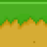 | 92 | 92 |  |  |  |  |  |  |  |  |  | 92 | `0x2002`: 92 |
| t003 |  | 5 | 5 |  |  |  |  |  |  |  |  |  | 5 | `0x2002`: 5 |
| t004 | 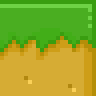 | 5 | 5 |  |  |  |  |  |  |  |  |  | 5 | `0x2002`: 5 |
| t005 | 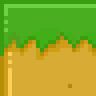 | 5 | 5 |  |  |  |  |  |  |  |  |  | 5 | `0x2002`: 5 |
| t007 | 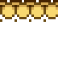 | 12 | 12 |  |  |  |  |  |  |  | 12 |  |  | `0x802`: 12 |
| t008 | 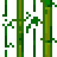 | 129 |  |  |  | 129 |  |  |  |  |  |  |  | `0x10`: 129 |
| t009 | 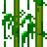 | 70 |  |  |  | 70 |  |  |  |  |  |  |  | `0x10`: 70 |
| t010 | 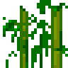 | 41 |  |  |  | 41 |  |  |  |  |  |  |  | `0x10`: 41 |
| t011 | 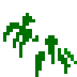 | 125 |  |  |  |  |  |  |  |  |  |  |  | `0x0`: 125 |
| t019 |  | 4 |  |  |  |  |  | 4 |  |  |  |  |  | `0x40`: 4 |
| t020 |  | 12 |  |  |  |  |  |  |  |  |  |  | 12 | `0x2000`: 12 |
| t021 |  | 14 |  |  |  |  |  |  |  |  |  |  | 14 | `0x2000`: 14 |
| t022 |  | 154 |  |  |  |  |  |  |  |  |  |  | 154 | `0x2000`: 154 |
| t023 |  | 22 |  |  |  |  |  |  |  |  |  |  | 22 | `0x2000`: 22 |
| t024 | 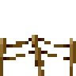 | 13 |  |  |  |  |  |  |  |  |  |  |  | `0x0`: 13 |
| t026 | 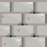 | 26 |  |  |  |  |  |  |  |  |  |  |  | `0x0`: 26 |
| t028 |  | 4 |  |  |  |  |  |  |  |  |  |  |  | `0x0`: 4 |
| t029 | 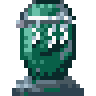 | 1 |  |  |  |  |  |  |  |  |  |  |  | `0x0`: 1 |
| t033 | 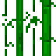 | 64 |  |  |  |  |  |  |  | 64 |  |  |  | `0x200`: 64 |
| t034 | 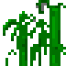 | 11 |  |  |  |  |  |  |  | 11 |  |  |  | `0x200`: 11 |
| t036 | 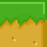 | 15 | 15 |  | 15 |  |  |  |  |  |  |  | 15 | `0x200a`: 15 |
| t037 | 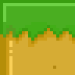 | 11 | 11 | 11 |  |  |  |  |  |  |  |  | 11 | `0x2006`: 11 |
| t038 | 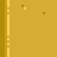 | 27 |  | 27 |  |  |  |  |  |  |  |  | 27 | `0x2004`: 27 |
| t039 |  | 14 |  |  | 14 |  |  |  |  |  |  |  | 14 | `0x2008`: 14 |
| t055 | 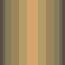 | 2 |  |  |  |  |  |  |  |  |  |  |  | `0x0`: 2 |
| t058 |  | 8 |  |  |  |  |  |  |  |  |  |  |  | `0x0`: 8 |
| t061 | 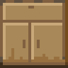 | 2 |  |  |  |  |  |  |  |  |  |  |  | `0x0`: 2 |
| t100 | 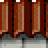 | 4 |  |  |  |  |  |  |  |  |  |  |  | `0x0`: 4 |
| t112 | 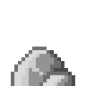 | 6 |  |  |  |  |  |  |  |  |  |  |  | `0x0`: 6 |
| t113 | 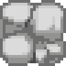 | 1 |  |  |  |  |  |  |  |  |  |  |  | `0x0`: 1 |
| t120 |  | 3 | 3 |  |  |  |  |  |  |  |  |  |  | `0x2`: 3 |
